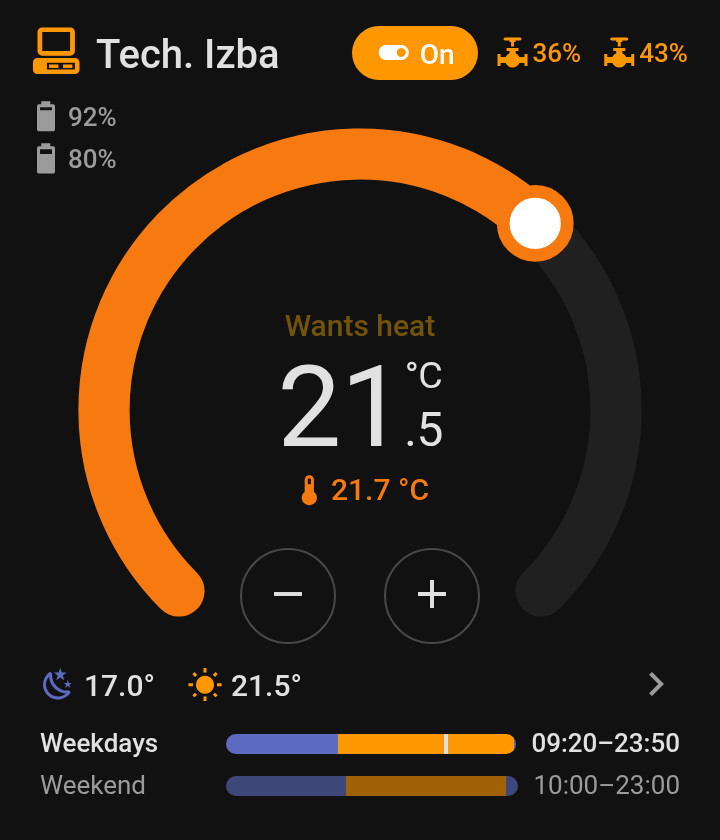
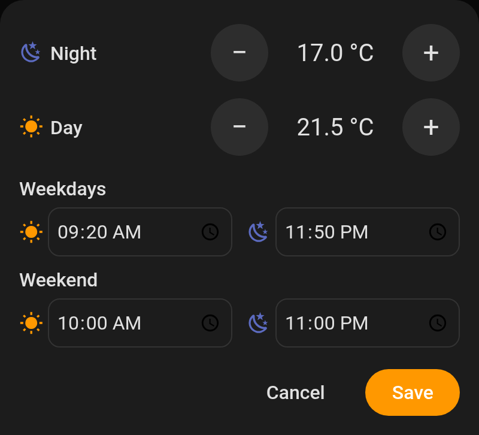

# Heating Room Card

A Home Assistant Lovelace card for a single room's heating. It shows:

- a large, color-changing **setpoint dial**. It is scroll-safe: a drag only starts on the arc, and a swipe anywhere else scrolls the page.
- the **actual heating status**. It tells apart "a TRV wants heat" and "the boiler is actually heating".
- the **weekday and weekend schedule** as two 24h timelines, both always visible (or a single *Every day* timeline for rooms without weekend times).
- a **schedule editor** popup. Nothing is written until you press Save.
- a **visual card editor**, so a room can be set up without writing YAML.

It works for rooms with one TRV or several.

<p>
  
  
</p>

## Install

### Marketplace / HACS (recommended, gives update notifications in HA)

1. In HA open **Marketplace** (HACS before HA 2026.11) **→ ⋮ (top right) → Custom repositories**.
2. Repository: `https://github.com/cRaZy92/ha-heating-card`, Type: **Dashboard**, then **Add**.
3. Search for **Heating Room Card**, click **Download**, then reload the browser/app.
   The dashboard resource is added for you.

New versions then show up as updates in **Settings → Updates**.

### Manual

1. `npm install && npm run build`
2. Copy `dist/heating-room-card.js` to `/config/www/heating-room-card.js`.
3. Go to **Settings → Dashboards → ⋮ → Resources → Add resource**:
   - URL: `/local/heating-room-card.js`
   - Type: **JavaScript module**
4. Hard-reload the browser or the app. When you update the file later, bump the cache: `/local/heating-room-card.js?v=2`.

## Configuration

### Visual editor

Add the card from the dashboard's card picker (**Heating Room Card**) and fill in the editor:

- **General:** name, icon, the boiler switch, and optional room temperature and humidity sensors.
- **Radiator valves (TRV):** add one row per TRV with its thermostat, valve-position sensor and battery sensor.
  With two or more TRVs, pick which one the dial controls; your sync automations keep the others in step.
- **Schedule:** use **Fill from helpers** and pick your helper prefix (for example `trv_izba`). It fills in
  `input_boolean.<prefix>_on_off`, `input_number.<prefix>_night_temp` / `_day_temp` and
  `input_datetime.<prefix>_day_time` / `_night_time` / `_day_time_weekend` / `_night_time_weekend`
  that exist. Any helper can also be picked by hand. For a room without schedule helpers, turn off **Use a schedule**.
- **Display:** when to show batteries and the low-battery threshold.

Until every required entity is picked, the card shows what is still missing instead of an error.
The same options can be written in YAML:

### Room with two TRVs

```yaml
type: custom:heating-room-card
name: Tech. Izba
icon: mdi:desktop-classic
climate: climate.shelly_trv_2            # the TRV the dial controls (sync automations handle the rest)
boiler: switch.kotol_rele
trvs:
  - climate: climate.shelly_trv_1
    valve: sensor.tech_izba_trv_1_poloha_ventilu
    battery: sensor.shelly_trv_1_battery
  - climate: climate.shelly_trv_2
    valve: sensor.tech_izba_trv_2_poloha_ventilu
    battery: sensor.shelly_trv_2_battery
schedule:
  enabled: input_boolean.trv_izba_on_off
  night_temp: input_number.trv_izba_night_temp
  day_temp: input_number.trv_izba_day_temp
  weekday:
    day: input_datetime.trv_izba_day_time
    night: input_datetime.trv_izba_night_time
  weekend:
    day: input_datetime.trv_izba_day_time_weekend
    night: input_datetime.trv_izba_night_time_weekend
```

### Room with one TRV

```yaml
type: custom:heating-room-card
name: Spálňa
icon: mdi:bed
boiler: switch.kotol_rele
trvs:
  - climate: climate.shelly_trv_3
    valve: sensor.spalna_trv_poloha_ventilu
    battery: sensor.shelly_trv_3_battery
schedule:
  enabled: input_boolean.trv_spalna_on_off
  night_temp: input_number.trv_spalna_night_temp
  day_temp: input_number.trv_spalna_day_temp
  weekday:
    day: input_datetime.trv_spalna_day_time
    night: input_datetime.trv_spalna_night_time
  weekend:
    day: input_datetime.trv_spalna_day_time_weekend
    night: input_datetime.trv_spalna_night_time_weekend
```

### Options

| Key | Required | Default | Description |
|---|---|---|---|
| `trvs` | yes | — | List of TRVs (at least 1). Each one has `climate` (required), plus optional `valve` (% sensor) and `battery` (% sensor). |
| `schedule.*` | no | — | Leave out the whole `schedule` block for a room without a schedule: the card then hides the On/Off pill, the timelines and the schedule tick. If present, it needs the `enabled` boolean, the `night_temp`/`day_temp` numbers, and the `weekday` `day`/`night` datetimes (time only). `weekend` `day`/`night` are optional: leave both out to use the weekday times every day. |
| `climate` | no | `trvs[0].climate` | The TRV whose setpoint the dial reads and writes. |
| `boiler` | no | — | Boiler relay switch. Without it, a TRV calling for heat shows **Heating**. |
| `temperature` | no | — | Room temperature sensor. The dial shows it instead of the TRV's own reading, which is skewed by the radiator. Falls back to the TRV when the sensor is unavailable. |
| `humidity` | no | — | Room humidity sensor, shown next to the current temperature. |
| `name` | no | the climate's friendly name | Room name. |
| `icon` | no | `mdi:radiator` | Room icon. It is tinted when the schedule is on (without a schedule: while the thermostat is on). |
| `battery_warning` | no | `25` | Batteries below this % are highlighted in red. |
| `show_battery` | no | `low` | `low`: show only the lowest battery, and only when it is below `battery_warning`. `always`: always show every TRV's battery in the dial's top-left corner. |

### Status

| Condition | Slovak | English |
|---|---|---|
| Climate unavailable | Nedostupné | Unavailable |
| Climate mode off | Vypnuté | Off |
| No TRV calling for heat | Nečinné | Idle |
| A TRV is calling for heat, boiler off | Čaká na teplo | Wants heat |
| A TRV is calling for heat, boiler on | Kúri | Heating |

Labels are in Slovak when the HA language is Slovak, and in English otherwise.

## Behaviour notes

- **− / + buttons:** each press moves the setpoint one step. The value is sent once, 1s after the last press.
- **Dial:** it sends `climate.set_temperature` once, when you release. The value stays dimmed until HA confirms it, and goes back to the real value if HA reports a different setpoint or hasn't confirmed within 60s (battery TRVs can take a while to report).
- **Schedule tick:** a tick on the dial marks the temperature the schedule expects right now. A `▲ plán X°` hint appears when the current setpoint differs from it. Both are hidden while the schedule is off.
- **Schedule editor:** tap the schedule to open it. Save writes only the fields you changed, through `input_number.set_value` and `input_datetime.set_datetime`.
- **TRV warnings:** in rooms with several TRVs, badges in the dial's top-left corner flag a TRV that is
  *Offline* (unavailable in HA), and *Out of sync* when another TRV's setpoint has differed from the
  dial's TRV for 3 minutes, which usually means a sync automation failed. A TRV that is off is not
  compared. Tap a badge to open that TRV.
- **Errors:** if any call to HA fails (setpoint, On/Off, schedule save), the dial reverts to the real value immediately and the card shows *Nepodarilo sa uložiť* / *Couldn't save* for 5s. The failure is logged to the console as a warning, and there are no unhandled errors.

## Releasing

Every push to `main` publishes a release automatically. The *Release* workflow runs the typecheck
and tests, builds the card, and publishes a GitHub release with `heating-room-card.js` attached.
HACS then offers it as an update.

- **Versions:** the patch number bumps on its own (`v0.1.0`, `v0.1.1`, …). To start a new minor or
  major line, set it in `package.json` (e.g. `0.2.0`) and push.
- **Skipping:** put `[skip release]` in the commit message to push without releasing.
- **Changelog:** the release notes, which HA shows in the update dialog, list the subject and body of every
  commit since the last release. Write commit messages for people using the card.

## Development

```bash
npm test          # unit tests (Vitest + happy-dom)
npm run dev       # then open http://localhost:5173/dev/index.html (mocked hass, 1- and 2-TRV rooms)
npm run build     # dist/heating-room-card.js
```

## License

MIT — see [LICENSE](LICENSE).
